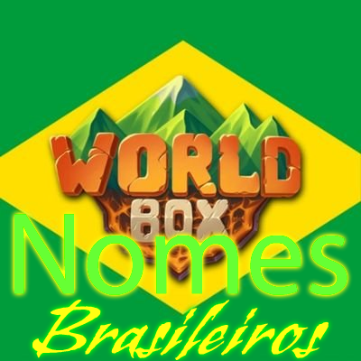

# Nomes Brasileiros

> Brazilian names for WorldBox: people, cities, kingdoms, clans, cultures, alliances and items.

**[Download Nomes Brasileiros 0.0.3](https://github.com/AgricheX/nomes-brasileiros/releases/latest/download/NomesBrasileiros.zip)**

| | |
| --- | --- |
| Game | WorldBox 0.22 / 0.23 |
| Mod loader | NCMS |
| Version | 0.0.3 |
| Author | Agriche |

English first, português do Brasil logo abaixo.

---

## English

### What it adds

- Brazilian names for units of every race.
- Names for cities, kingdoms, clans, cultures and alliances.
- Names and mottos for alliances and clans.
- Names for weapons, armor and items.

### How to install

1. Install NCMS for WorldBox 0.22 / 0.23.
2. Download **NomesBrasileiros.zip** with the link above.
3. Extract it into the `Mods` folder of your WorldBox installation, so you get `Mods/NomesBrasileiros/mod.json`.
4. Start the game.

### Help

Questions and bug reports: [Agriche Community on Discord](https://discord.gg/s3EbgNSsJW).

---

## Português (Brasil)

### O que o mod adiciona

- Nomes brasileiros para as unidades de todas as raças.
- Nomes para cidades, reinos, clãs, culturas e alianças.
- Nomes e lemas para alianças e clãs.
- Nomes para armas, armaduras e itens.

### Como instalar

1. Instale o NCMS para o WorldBox 0.22 / 0.23.
2. Baixe o **NomesBrasileiros.zip** pelo link acima.
3. Extraia na pasta `Mods` do WorldBox, de forma que fique `Mods/NomesBrasileiros/mod.json`.
4. Abra o jogo.

### Ajuda

Dúvidas e bugs: [Agriche Community no Discord](https://discord.gg/s3EbgNSsJW).

---

WorldBox © Maxim Karpenko. This is a free, fan-made mod, not affiliated with the WorldBox developers.
